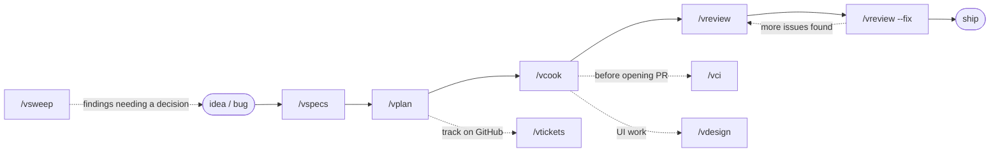

# vskills

🌐 English | [Tiếng Việt](README.vi.md)

This guide describes how a set of Claude Code skills is installed and used to carry a coding task from specification to review, how the optional job queue keeps the machine responsive while Claude runs heavy commands, and how the repository is maintained.

## General introduction

### Purpose

The skills cover the lifecycle of a coding task: specification, plan, implementation, review and fix, with GitHub tracking, UI redesign, unattended sweeps through a backlog, local migration rollback and user-guide writing as support. Each skill is a plain `SKILL.md` file linked into `~/.claude/skills`; no plugin layer and no configuration file are involved. Every skill exists in English (`SKILL.md`) and in Vietnamese (`SKILL.vi.md`).

### Glossary

| Term | Meaning |
|---|---|
| Skill | A set of written instructions that Claude Code follows when a slash command such as `/vspecs` is typed. |
| Explicit-only skill | A skill marked with `*` in this guide. It runs only when typed by hand and is never started automatically. |
| Specs file | A plain-language description of a feature and its edge cases, stored in `plans/specs/`. |
| Plan | A directory holding `plan.md` and one `phase-XX-*.md` file per phase. |
| Review report | The file `.code-review/REPORT.md`, with findings grouped as CRITICAL, WARNING and SUGGESTION. |
| Starter `CLAUDE.md` | A general rule file installed as `~/.claude/CLAUDE.md` when no such file exists. |
| `jobq` | The optional job queue that runs heavy commands a few at a time. |
| Guard hook | The `jobq-guard` hook, which stops heavy commands from running outside the queue. |

### Stages of a task

| Stage | Content | Skill | Result |
|---|---|---|---|
| 1. Specify | Specs written in plain language; edge cases decided together with the developer | `/vspecs` | `plans/specs/<feature>.md` |
| 2. Plan | Every case compared with the code (PASS, FAIL or MISSING) and grouped into phases | `/vplan` | `plan.md` and phase files |
| 3. Track (optional) | One epic issue with linked sub-issues | `/vtickets`* | Issues on GitHub |
| 4. Implement | Branch, tests first, code, review against `CLAUDE.md`, test run, commit and pull request | `/vcook`* | Pull request |
| 5. Review | Findings on a diff, pull request, branch or directory | `/vreview` | `.code-review/REPORT.md` |
| 6. Fix | Findings fixed in priority order, with confirmation before anything risky | `/vreview --fix` | Fix commits |



`/vsweep` and `/vrollback` run independently of this sequence.

### Illustrative case

A developer has to add appointment rebooking to an existing application. The feature is first written down with `/vspecs`, which researches the code and real usage and settles the edge cases with the developer. `/vplan` then compares every case with the code and produces a phased plan, and `/vcook` carries the plan out on a new branch, tests first, ending with a pull request. `/vreview` reads the pull request and writes the review report, `/vreview --fix` works through the findings, and `/vci` confirms that the whole repository still type-checks and builds.

### Access

No account is needed. After installation the skills appear in Claude Code as slash commands. Text in backticks is typed exactly as written.

## Role 1: Developer who uses the skills

This role installs the skills once and then calls them from Claude Code inside any project. The skills read and write files in the project being worked on, such as `plans/` and `.code-review/`.

### Installation

#### Step 1 - Prepare the requirements

| Component | Used for | Needed |
|---|---|---|
| Claude Code CLI | Running every skill | Always |
| `git` | Cloning the repository and the branches and commits the skills create | Always |
| `bash` | `install.sh` and helper scripts | Always |
| `gh` | `/vtickets` and pull-request steps; GitHub-related skills run in reduced form without it | Optional |
| Node.js | The local webapp used by `/vspecs` and `/vreview --fix` for visual steps, `scripts/check-skills.js` and the lint rules | When those features are used |
| `jq` | The job queue guard hook, the `jobq web` page and the evals | When those features are used |

#### Step 2 - Clone and install

The repository is cloned and the installer is started from its root. The skills are linked, not copied, into `~/.claude/skills`, so an edit in either place changes the same file.

```bash
git clone git@github.com:vyvu99/vskills.git
cd vskills
./install.sh
```

A real file or directory already present at a destination is moved aside to `<path>.bak.<timestamp>`. Running the installer again removes skills that no longer exist in the repository.

#### Step 3 - Choose the options

| Option | Effect |
|---|---|
| `--lang=vi` | Installs the Vietnamese version of every skill instead of English |
| `--with-scripts` | Also installs the lint rules and the job queue (see Role 2) |
| `--with-claude-md` | Also installs the starter `CLAUDE.md` as `~/.claude/CLAUDE.md`; skipped when that file exists |
| `--dry-run` | Prints what would happen without changing anything |

### Core pipeline

#### Step 4 - Write the specs

The specs describe a feature in plain language, without code or file references. `/vspecs` reads the code, researches real usage, proposes edge cases and asks the developer to decide each one.

```
/vspecs Feature: appointment rebooking
```

The result is `plans/specs/appointment-rebooking.md`. Running the skill again on the same feature extends the existing file.

#### Step 5 - Produce the plan

`/vplan` takes a specs file, compares every case with the current code and marks it PASS, FAIL or MISSING, then groups the work into phases.

```
/vplan plans/specs/appointment-rebooking.md
```

The result is a directory with `plan.md` and one `phase-XX-*.md` file per phase. The skill writes no code.

#### Step 6 - Track the plan on GitHub (optional)

`/vtickets` is an explicit-only skill. It creates one epic issue and linked sub-issues from a plan directory, using the `gh` command. Issue text is non-technical and migrations are combined into one sub-issue.

```
/vtickets plans/appointment-rebooking
```

#### Step 7 - Implement

`/vcook` is an explicit-only skill. It accepts a plan directory or a short description, creates the branch, writes tests first, codes backend and frontend, reviews the result against `CLAUDE.md`, runs the tests, commits and opens a pull request. It stops when the working tree has uncommitted changes or when the plan does not match the code.

```
/vcook plans/appointment-rebooking
/vcook plans/appointment-rebooking --issue 482
```

#### Step 8 - Review and fix

`/vreview` reviews a branch, a pull request (`#482` or its URL), a time window (`--since`) or chosen directories (`--path`). It writes `.code-review/REPORT.md` and edits no source file. Adding `--fix` makes the skill fix the findings in priority order and ask before anything risky; an existing report directory can also be passed to fix it directly.

```
/vreview #482
/vreview --fix
```

### Support skills

#### Step 9 - Check the whole repository

`/vci` runs format, typecheck, build and lint in parallel across all packages or chosen ones of a JavaScript or TypeScript repository, fixes what it finds and rechecks only the packages it fixed. The package manager and workspaces are detected automatically.

```
/vci --changed
/vci --test
```

#### Step 10 - Redesign an interface

`/vdesign` redesigns the interface of a page, component, feature or pull-request diff. It reads the real user and task, researches current design practice, decides eighteen style and structure criteria on its own and then audits, fixes and verifies at three screen widths.

```
/vdesign /clients/[id]
/vdesign --diff
```

#### Step 11 - Run an unattended sweep

`/vsweep` works through an open-ended body of work until a deadline, such as a code audit, a backlog or a research list. It finishes clear-cut items, records ambiguous ones as pending decisions and keeps its progress in a state file. An optional stop-guard hook, enabled manually (see the header of `skills/vsweep/stop-guard.sh`), keeps it running until the deadline.

```
/vsweep --until 06:00
/vsweep --resume
```

The second form implements the decisions recorded during an earlier sweep.

#### Step 12 - Roll back a local migration

`/vrollback` is an explicit-only skill intended for the local development database. It detects the framework and database, rolls back the named migration and removes its tracking row. The database name has to be typed to confirm before anything is rolled back.

```
/vrollback 0007_add_status
```

#### Step 13 - Write a user guide

`/vguide` writes a formal user guide for a product, feature or flow, organized by role, with numbered steps and screenshots where the product has a screen. It checks who can do what against the real product.

```
/vguide Feature: checkout, roles: customer, admin
```

### Choosing a skill

| Situation | Skill |
|---|---|
| No specs exist for the feature | `/vspecs` |
| Specs are ready and a plan is needed | `/vplan` |
| A plan or a quick task is ready for code | `/vcook` |
| A branch or pull request needs review | `/vreview` |
| A review report needs fixing | `/vreview --fix` |
| A type-check and build sanity run is needed | `/vci` |
| A plan needs tracking on GitHub | `/vtickets` |
| A page needs a new interface | `/vdesign` |
| A backlog is to be worked through unattended | `/vsweep` |
| A migration was run by mistake on the local database | `/vrollback` |
| A user guide is needed | `/vguide` |

### Points to remember

- Skills marked `*` run only when typed by hand.
- Specs and plans are stored under `plans/` of the project being worked on; review reports are stored in `.code-review/`.
- Full behavior, flags and edge cases of each skill are in `skills/<name>/SKILL.md`.

## Role 2: Developer who uses the job queue

This role installs the optional job queue so that Claude can start many heavy commands (tests, type checks, builds, end-to-end runs, image processing) without slowing the machine down. The queue is a small bash tool with nothing to configure: its limits are taken from the number of cores and the amount of memory, and are tightened by what is measured while commands run.

#### Step 1 - Install the commands

The installer links the job queue into `~/.claude/scripts/job-queue` and the commands `jobq`, `stepper` and `lint-script` into `~/.local/bin`, which has to be on `PATH`.

```bash
./install.sh --with-scripts
```

#### Step 2 - Add the guard hook

The hook is added to the `hooks.PreToolUse` list in `~/.claude/settings.json`. It rejects heavy commands that bypass the queue and requires `jobq run` to be started in the background, so that Claude continues with other work while commands wait. The hook needs `jq`.

```json
{ "matcher": "Bash", "hooks": [{ "type": "command", "command": "$HOME/.claude/scripts/job-queue/jobq-guard", "timeout": 5 }] }
```

A command that has to finish before anything else can continue is started with `JOBQ_FG=1` in front of it.

#### Step 3 - Run a command through the queue

Everything after `--` is the command to run. The command waits for its turn, runs at low priority with a time limit of 900 seconds, and its output is shown as usual.

```bash
jobq run -- pnpm --filter api test
jobq run -t 1800 -- pnpm test:e2e
```

`-t` sets the time limit in seconds for one command and `-w` sets how long the command may wait in the queue (7200 seconds by default). `--cost cpu=3,mem=2000` declares the expected cores and megabytes for a command that has never run before.

#### Step 4 - Follow the queue

`jobq status` lists what is running and what waits. `jobq web` opens a live dashboard as a static page in the browser: machine load, running slots with their time limits, the waiting queue with the reason each command waits, the history of the last fifty commands with a filter for failures, and the commands that use the most resources.

```bash
jobq status
jobq web
```

#### Step 5 - Read earlier output

The queue keeps the last fifty commands together with their output. Number 1 is the most recent command.

```bash
jobq logs
jobq logs 1
```

#### Step 6 - Split a command that exceeds its time limit

A command that runs past its time limit is stopped with exit code 124. The report names the command, shows the last twenty lines of output and tells Claude to split the work into smaller batches. `jobq split` divides a list of files into batches that can be pasted directly into separate `jobq run` commands.

```bash
jobq split 4 -- tests/*.ts
```

#### Step 7 - Write check scripts in one shape

New test and check scripts start from `template.sh` and are verified with `lint-script`. A script that grows beyond 120 lines, or that has several heavy phases, is divided into numbered step files and run with `stepper`, which stops at the first failing step and resumes there on the next run.

```bash
cp ~/.claude/scripts/job-queue/template.sh check-foo.sh
lint-script check-foo.sh
stepper plans/scripts/foo/steps
```

### Points to remember

- Limits are derived from the machine: at most one command per core, CPU reservations up to 150% of the cores, memory reservations up to 75% of installed memory.
- New commands wait while CPU load is at or above 150% of the cores, free memory is under 1500 MB, memory pressure is critical or swap is growing quickly. After one command starts, eight seconds pass before the next one is admitted.
- Commands that have run for ten seconds are counted by their measured use instead of an estimate.
- Exit code 75 means a command waited too long in the queue; exit code 124 means it ran past its time limit.
- A guide to every command and its internals is in [`scripts/job-queue/README.md`](scripts/job-queue/README.md).

## Role 3: Maintainer

This role adds, changes and removes skills and keeps the repository consistent.

### Repository structure

| Location | Content |
|---|---|
| `install.sh` | Links `skills/` (and `scripts/` with `--with-scripts`) into `~/.claude` |
| `skills/<name>/SKILL.md` | The skill in English |
| `skills/<name>/SKILL.vi.md` | The same skill in Vietnamese, with the same number of lines |
| `skills/<name>/references/`, `scripts/` | Optional material installed with the skill |
| `skills/<name>/*.sh` | Optional helpers at the skill root, such as `skills/vsweep/stop-guard.sh` |
| `skills/_vskills-shared/` | Reference documents shared by several skills |
| `claude-md/CLAUDE.md` | The starter rule file installed by `--with-claude-md` |
| `evals/` | Trigger and behavior evals, run with `scripts/run-evals.sh`; the run calls `claude -p` and is billable |
| `web/` | The local webapp used by `/vspecs` and `/vreview --fix` for visual steps |
| `scripts/<name>/` | Optional tools: `lint-rules` and `job-queue` |

#### Step 1 - Add a skill

The skill folder is created with an English file and a Vietnamese file of equal length, the installer is run, and the checker confirms that frontmatter, description length and English-Vietnamese parity are valid.

```bash
mkdir skills/<skill-name>
./install.sh
node scripts/check-skills.js
git add . && git commit -m "feat: add <skill-name> skill"
```

#### Step 2 - Remove a skill

After the folder is deleted, other files are searched for references to the removed name, and the installer removes the orphaned link.

```bash
rm -rf skills/<skill-name>
grep -rl "<skill-name>" skills/ README.md README.vi.md
./install.sh
git add . && git commit -m "chore: remove <skill-name> skill"
```

#### Step 3 - Add a lint rule after a harvest pass

`/vreview --harvest` writes the rule script directly into `~/.claude/scripts/lint-rules/rules/`, which is linked to `scripts/lint-rules/rules/` when installed with `--with-scripts`. The rule is committed from the repository.

```bash
git add . && git commit -m "feat(lint): add <rule-name> rule"
git push
```

### Points to remember

- A skill counts as finished only when the English and Vietnamese files have the same number of lines.
- Evals call a paid service; they are started deliberately and never as part of routine checks.
- Behavior of the job queue, including its tests (`scripts/job-queue/check-jobq`), is documented in `scripts/job-queue/README.md`.

## License

Copyright (c) 2026 vyvu. Licensed under [AGPL-3.0](LICENSE).
