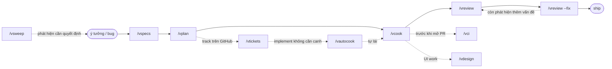

# vskills

🌐 [English](README.md) | Tiếng Việt

Bộ skill Claude Code cá nhân, bao trọn vòng đời 1 task code: viết specs, lập plan, implement, review, fix, ship — cộng thêm track trên GitHub, redesign UI, rà backlog không cần canh, và rollback migration ở local.

File `SKILL.md` thuần, symlink từ repo này vào `~/.claude/skills`. Không qua plugin, không có config. Mỗi skill có 2 bản: English (`SKILL.md`) và tiếng Việt (`SKILL.vi.md`).

## Cài đặt

**Yêu cầu:** Claude Code CLI, `git`, `bash`. `gh` là tùy chọn — skill liên quan GitHub vẫn chạy được ở mức giảm khi thiếu.

```bash
git clone git@github.com:vyvu99/vskills.git
cd vskills
./install.sh                       # symlink skills/ → ~/.claude/skills (bản English)
./install.sh --lang=vi             # bản tiếng Việt
./install.sh --with-scripts        # + lint rule cá nhân (opt-in)
./install.sh --with-claude-md      # + starter ~/.claude/CLAUDE.md tổng quát (opt-in, bỏ qua nếu đã có)
./install.sh --dry-run             # chỉ xem trước
```

Skill được symlink chứ không copy — sửa ở đâu cũng là cùng 1 file. Chạy lại `install.sh` sẽ dọn skill nào đã bị xóa khỏi repo từ lần cài trước. File/thư mục thật (không phải symlink) đang nằm ở đích sẽ được đổi tên thành `<path>.bak.<timestamp>`, không bị xóa.

## Skills

`*` — chỉ chạy khi gọi tay; assistant không tự động dùng.

### Core pipeline

| Skill | Làm gì | Ví dụ |
|---|---|---|
| `vspecs` | Viết/cập nhật specs: research codebase + cách người dùng thật đang làm, rồi cùng bạn đi qua từng edge case. Output chỉ ngôn ngữ thường — không code, không file:line. | `/vspecs Feature: đặt lịch tái khám` |
| `vplan` | Biến 1 file specs thành plan theo từng phase, verify từng case với code thật (PASS/FAIL/MISSING). | `/vplan plans/specs/dat-lich-tai-kham.md` |
| `vcook`* | Implement 1 plan hoặc task từ đầu tới cuối: branch, viết test trước, code, chỉ dùng generated SDK, review theo CLAUDE.md, mở PR. Dừng lại nếu working tree dơ hoặc plan lệch code. | `/vcook plans/dat-lich-tai-kham` |
| `vreview` | Review 1 diff/PR/branch/thư mục: pre-scan lint, review song song theo file, tổng hợp, và 1 lượt adversarial. Ghi `.code-review/REPORT.md`. Mặc định chỉ đọc; thêm `--fix` để fix report theo thứ tự ưu tiên (lint, Critical, Warning, cross-group, Suggestion), dừng lại hỏi trước bất kỳ thứ gì rủi ro — hoặc truyền một report directory có sẵn để fix thẳng. | `/vreview #482` · `/vreview --fix` |

### Track trên GitHub

| Skill | Làm gì | Ví dụ |
|---|---|---|
| `vtickets`* | Tạo hoặc đồng bộ 1 GitHub epic + sub-issues từ 1 plan directory. Idempotent. | `/vtickets plans/dat-lich-tai-kham` |
| `vautocook`* | Implement từng sub-issue của 1 GitHub epic không cần canh, mỗi sub-issue 1 phiên mới, tất cả gộp vào 1 PR duy nhất của epic. Cần xác nhận trước khi chạy; không có phương án dự phòng nếu thiếu `gh`/`claude`. | `/vautocook <epic-url>` |

### Hỗ trợ

| Skill | Làm gì | Ví dụ |
|---|---|---|
| `vci` | Typecheck, build, lint song song cho cả repo JS/TS; format và test tùy chọn chạy sau. Tự phát hiện package manager/workspace. | `/vci --changed` |
| `vdesign` | Redesign UI 1 page/component qua quy trình scan → audit → fix → verify. Mỗi lần chạy tự quyết cả 18 tiêu chí style/cấu trúc dựa trên research thiết kế trực tiếp và việc đọc người dùng/task thật — không hỏi trước. | `/vdesign /clients/[id]` |
| `vsweep` | Chạy 1 đợt rà khối việc mở thuộc bất kỳ loại nào (code, nghiên cứu, viết lách, dữ liệu, vận hành, brainstorm) không cần canh, có giới hạn thời gian: dispatch subagent (mặc định 1 cái mỗi lần), tự làm xong việc rõ ràng kèm verify phù hợp loại việc, ghi nhận cái mơ hồ thành quyết định đang chờ, lưu tiến độ trong state file. Hook stop-guard tuỳ chọn (bật thủ công — xem comment đầu `skills/vsweep/stop-guard.sh`) giữ nó chạy tới deadline. Resume lại sau để triển khai các quyết định đó với cùng mức kỹ lưỡng. | `/vsweep --until 06:00` |
| `vrollback`* | Rollback 1 migration đã chạy trên DB xác nhận là local + xóa tracking record. Từ chối target không rõ local. | `/vrollback 0007_add_status` |

Chi tiết đầy đủ, flag, edge case: `skills/<name>/SKILL.vi.md`.

## Sơ đồ luồng



`/vrollback` và `/vsweep` chạy độc lập — không nằm trong pipeline này.

## Cần skill nào?

```
├─ "Feature này chưa có specs"                    → /vspecs
├─ "Đã có specs, cần lập plan implementation"     → /vplan
├─ "Đã có plan (hoặc chỉ 1 task nhanh), cần code" → /vcook
├─ "Cần review 1 branch/PR"                       → /vreview
├─ "Có report review, cần fix"                    → /vreview --fix
├─ "Cần check nhanh typecheck/build"              → /vci
├─ "Cần track 1 plan trên GitHub"                 → /vtickets
├─ "Có 1 epic GitHub, muốn build không cần canh"  → /vautocook
├─ "Cần redesign UI 1 trang"                      → /vdesign
├─ "Rà 1 backlog, không cần canh, tới 1 deadline"  → /vsweep
└─ "Lỡ chạy nhầm migration ở local"                → /vrollback
```

---

## Dành cho maintainer

<details>
<summary>Cấu trúc, thêm/xóa skill, lint rules</summary>

```
vskills/
├── install.sh                    # symlink skills/ (+ scripts/ nếu --with-scripts) vào ~/.claude
├── skills/<name>/SKILL.md        # bản English
├── skills/<name>/SKILL.vi.md     # bản tiếng Việt, cùng số dòng (kiểm bởi scripts/check-skills.js)
├── skills/<name>/scripts/        # tùy chọn, cài cùng skill
├── skills/<name>/references/     # tùy chọn, cài cùng skill
├── skills/<name>/*.sh            # tuỳ chọn, script phụ ở gốc skill (vd vsweep/stop-guard.sh), symlink từng file
├── skills/_vskills-shared/       # reference dùng chung, luôn symlink
├── claude-md/CLAUDE.md           # CLAUDE.md starter, được copy khi dùng --with-claude-md
├── evals/                        # eval trigger + behavior (chạy bằng scripts/run-evals.sh; gọi `claude -p`, tốn phí)
├── web/                          # webapp local cho vspecs/vreview --fix ở các bước cần UI (node web/server.mjs)
└── scripts/<name>/               # vd lint-rules — opt-in, khác với skills/<name>/scripts/
```

**Thêm skill mới:**
```bash
mkdir skills/<skill-name>
# viết skills/<skill-name>/SKILL.md (+ SKILL.vi.md, cùng số dòng)
./install.sh
node scripts/check-skills.js   # lint frontmatter, độ dài description, cân bằng EN/VI
git add . && git commit -m "feat: add <skill-name> skill"
```

**Xóa 1 skill:**
```bash
rm -rf skills/<skill-name>
grep -rl "<skill-name>" skills/ README.md README.vi.md   # bắt cross-reference còn sót
./install.sh   # tự dọn symlink mồ côi dưới ~/.claude/skills
git add . && git commit -m "chore: remove <skill-name> skill"
```

**Thêm lint rule sau 1 lượt `vreview --harvest`:**

Phase 5 ghi thẳng rule script vào `~/.claude/scripts/lint-rules/rules/` (symlink từ `scripts/lint-rules/rules/` khi cài với `--with-scripts`) — chỉ cần commit những gì đã có sẵn:
```bash
git add . && git commit -m "feat(lint): add <rule-name> rule"
git push
```

</details>

## License

[MIT](LICENSE)
