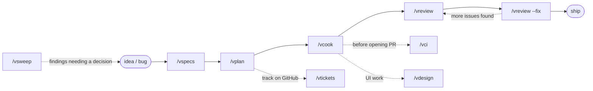

# vskills

🌐 [English](README.md) | Tiếng Việt

Tài liệu này mô tả cách cài đặt và sử dụng một bộ skill của Claude Code để đưa một task lập trình từ khâu viết specs đến khâu review, cách hàng đợi lệnh tùy chọn giữ cho máy luôn phản hồi khi Claude chạy các lệnh nặng, và cách bảo trì kho mã.

## Giới thiệu chung

### Mục đích

Bộ skill bao trọn vòng đời của một task lập trình: viết specs, lập plan, triển khai, review và sửa, kèm theo các phần hỗ trợ gồm theo dõi trên GitHub, thiết kế lại giao diện, rà soát backlog không cần canh, rollback migration ở máy cục bộ và viết hướng dẫn sử dụng. Mỗi skill là một tệp `SKILL.md` thuần, được liên kết vào `~/.claude/skills`; không có lớp plugin và không có tệp cấu hình. Mọi skill đều có bản tiếng Anh (`SKILL.md`) và bản tiếng Việt (`SKILL.vi.md`).

### Thuật ngữ

| Thuật ngữ | Ý nghĩa |
|---|---|
| Skill | Bộ chỉ dẫn viết sẵn mà Claude Code làm theo khi một lệnh gạch chéo như `/vspecs` được gõ. |
| Skill chỉ gọi tay | Skill đánh dấu `*` trong tài liệu này. Chỉ chạy khi được gõ tay và không bao giờ tự khởi động. |
| Tệp specs | Bản mô tả một tính năng và các trường hợp biên bằng ngôn ngữ thường, lưu trong `plans/specs/`. |
| Plan | Thư mục gồm `plan.md` và mỗi pha một tệp `phase-XX-*.md`. |
| Báo cáo review | Tệp `.code-review/REPORT.md`, các phát hiện được chia thành CRITICAL, WARNING và SUGGESTION. |
| `CLAUDE.md` khởi tạo | Tệp quy tắc chung được cài thành `~/.claude/CLAUDE.md` khi chưa có tệp nào như vậy. |
| `jobq` | Hàng đợi lệnh tùy chọn, chạy các lệnh nặng từng vài lệnh một. |
| Hook chặn | Hook `jobq-guard`, ngăn các lệnh nặng chạy ngoài hàng đợi. |

### Các giai đoạn của một task

| Giai đoạn | Nội dung | Skill | Kết quả |
|---|---|---|---|
| 1. Viết specs | Specs bằng ngôn ngữ thường; các trường hợp biên được quyết cùng lập trình viên | `/vspecs` | `plans/specs/<feature>.md` |
| 2. Lập plan | Từng trường hợp được so với code (PASS, FAIL hoặc MISSING) rồi gom thành các pha | `/vplan` | `plan.md` và các tệp pha |
| 3. Theo dõi (tùy chọn) | Một epic kèm các sub-issue liên kết | `/vtickets`* | Issue trên GitHub |
| 4. Triển khai | Tạo branch, viết test trước, code, review theo `CLAUDE.md`, chạy test, commit và mở pull request | `/vcook`* | Pull request |
| 5. Review | Các phát hiện trên diff, pull request, branch hoặc thư mục | `/vreview` | `.code-review/REPORT.md` |
| 6. Sửa | Các phát hiện được sửa theo thứ tự ưu tiên, hỏi xác nhận trước mọi việc rủi ro | `/vreview --fix` | Các commit sửa lỗi |



`/vsweep` và `/vrollback` chạy độc lập với chuỗi này.

### Tình huống minh họa

Một lập trình viên cần thêm tính năng đặt lại lịch hẹn vào một ứng dụng sẵn có. Tính năng trước hết được viết thành specs bằng `/vspecs`: skill đọc code, tìm hiểu cách người dùng thật dùng và chốt các trường hợp biên cùng lập trình viên. Tiếp đó `/vplan` so từng trường hợp với code và lập plan theo pha, còn `/vcook` thực hiện plan trên một branch mới, viết test trước và kết thúc bằng một pull request. `/vreview` đọc pull request và viết báo cáo review, `/vreview --fix` xử lý lần lượt các phát hiện, và `/vci` xác nhận cả kho vẫn qua kiểm tra kiểu và build.

### Truy cập

Không cần tài khoản. Sau khi cài đặt, các skill xuất hiện trong Claude Code dưới dạng lệnh gạch chéo. Chữ trong dấu backtick được gõ đúng như viết.

## Vai trò 1: Lập trình viên dùng các skill

Vai trò này cài các skill một lần rồi gọi chúng từ Claude Code trong bất kỳ dự án nào. Các skill đọc và ghi tệp trong dự án đang làm việc, chẳng hạn `plans/` và `.code-review/`.

### Cài đặt

#### Bước 1 - Chuẩn bị yêu cầu

| Thành phần | Dùng để | Cần khi |
|---|---|---|
| Claude Code CLI | Chạy mọi skill | Luôn luôn |
| `git` | Sao chép kho mã, cùng các branch và commit mà skill tạo ra | Luôn luôn |
| `bash` | `install.sh` và các script hỗ trợ | Luôn luôn |
| `gh` | `/vtickets` và các bước pull request; thiếu `gh` thì các skill liên quan GitHub chạy ở mức giảm | Tùy chọn |
| Node.js | Webapp cục bộ mà `/vspecs` và `/vreview --fix` dùng cho các bước trực quan, `scripts/check-skills.js` và các lint rule | Khi dùng các chức năng đó |
| `jq` | Hook chặn của hàng đợi lệnh, trang `jobq web` và các eval | Khi dùng các chức năng đó |

#### Bước 2 - Sao chép và cài đặt

Kho mã được sao chép và trình cài đặt được chạy từ thư mục gốc của kho. Các skill được liên kết, không sao chép, vào `~/.claude/skills`, nên sửa ở nơi nào thì cũng là sửa cùng một tệp.

```bash
git clone git@github.com:vyvu99/vskills.git
cd vskills
./install.sh
```

Tệp hoặc thư mục thật đang có sẵn ở đích được đổi tên thành `<path>.bak.<timestamp>`. Chạy lại trình cài đặt sẽ gỡ các skill không còn trong kho.

#### Bước 3 - Chọn các tùy chọn

| Tùy chọn | Tác dụng |
|---|---|
| `--lang=vi` | Cài bản tiếng Việt của mọi skill thay cho bản tiếng Anh |
| `--with-scripts` | Cài thêm các lint rule và hàng đợi lệnh (xem Vai trò 2) |
| `--with-claude-md` | Cài thêm `CLAUDE.md` khởi tạo thành `~/.claude/CLAUDE.md`; bỏ qua nếu tệp đó đã có |
| `--dry-run` | In ra những gì sẽ xảy ra mà không thay đổi gì |

### Chuỗi chính

#### Bước 4 - Viết specs

Specs mô tả một tính năng bằng ngôn ngữ thường, không có code hay tham chiếu tệp. `/vspecs` đọc code, tìm hiểu cách dùng thực tế, đề xuất các trường hợp biên và để lập trình viên quyết từng trường hợp.

```
/vspecs Feature: appointment rebooking
```

Kết quả là `plans/specs/appointment-rebooking.md`. Chạy lại skill trên cùng tính năng sẽ bổ sung vào tệp đã có.

#### Bước 5 - Lập plan

`/vplan` nhận một tệp specs, so từng trường hợp với code hiện tại và đánh dấu PASS, FAIL hoặc MISSING, rồi gom công việc thành các pha.

```
/vplan plans/specs/appointment-rebooking.md
```

Kết quả là một thư mục gồm `plan.md` và mỗi pha một tệp `phase-XX-*.md`. Skill không viết code.

#### Bước 6 - Theo dõi plan trên GitHub (tùy chọn)

`/vtickets` là skill chỉ gọi tay. Skill tạo một epic và các sub-issue liên kết từ một thư mục plan, bằng lệnh `gh`. Nội dung issue không mang tính kỹ thuật và các migration được gộp thành một sub-issue.

```
/vtickets plans/appointment-rebooking
```

#### Bước 7 - Triển khai

`/vcook` là skill chỉ gọi tay. Skill nhận một thư mục plan hoặc một mô tả ngắn, tạo branch, viết test trước, code backend và frontend, review kết quả theo `CLAUDE.md`, chạy test, commit và mở pull request. Skill dừng lại khi cây làm việc còn thay đổi chưa commit hoặc khi plan không khớp với code.

```
/vcook plans/appointment-rebooking
/vcook plans/appointment-rebooking --issue 482
```

#### Bước 8 - Review và sửa

`/vreview` review một branch, một pull request (`#482` hoặc URL của nó), một khoảng thời gian (`--since`) hoặc các thư mục được chọn (`--path`). Skill viết `.code-review/REPORT.md` và không sửa tệp mã nguồn nào. Thêm `--fix` thì skill sửa các phát hiện theo thứ tự ưu tiên và hỏi trước mọi việc rủi ro; cũng có thể truyền một thư mục báo cáo đã có để sửa trực tiếp.

```
/vreview #482
/vreview --fix
```

### Các skill hỗ trợ

#### Bước 9 - Kiểm tra toàn bộ kho

`/vci` chạy format, typecheck, build và lint song song trên mọi gói hoặc các gói được chọn của một kho JavaScript hoặc TypeScript, sửa những gì tìm thấy và chỉ kiểm tra lại các gói đã sửa. Trình quản lý gói và workspace được nhận diện tự động.

```
/vci --changed
/vci --test
```

#### Bước 10 - Thiết kế lại giao diện

`/vdesign` thiết kế lại giao diện của một trang, component, tính năng hoặc diff của pull request. Skill đọc người dùng và tác vụ thật, tìm hiểu thực hành thiết kế hiện hành, tự quyết mười tám tiêu chí về phong cách và cấu trúc rồi kiểm tra, sửa và xác minh ở ba độ rộng màn hình.

```
/vdesign /clients/[id]
/vdesign --diff
```

#### Bước 11 - Chạy rà soát không cần canh

`/vsweep` xử lý một khối công việc mở cho đến hạn chót, chẳng hạn kiểm tra mã, backlog hoặc danh sách cần nghiên cứu. Skill hoàn tất các mục rõ ràng, ghi các mục chưa rõ thành quyết định chờ xử lý và lưu tiến độ vào một tệp trạng thái. Hook stop-guard tùy chọn, bật thủ công (xem phần đầu của `skills/vsweep/stop-guard.sh`), giữ cho skill tiếp tục chạy đến hạn chót.

```
/vsweep --until 06:00
/vsweep --resume
```

Dạng thứ hai thực hiện các quyết định đã ghi trong lần rà soát trước.

#### Bước 12 - Rollback migration ở máy cục bộ

`/vrollback` là skill chỉ gọi tay, dành cho cơ sở dữ liệu phát triển ở máy cục bộ. Skill nhận diện framework và cơ sở dữ liệu, rollback migration được chỉ định và xóa dòng theo dõi của nó. Tên cơ sở dữ liệu phải được gõ lại để xác nhận trước khi bất cứ thứ gì được rollback.

```
/vrollback 0007_add_status
```

#### Bước 13 - Viết hướng dẫn sử dụng

`/vguide` viết một bản hướng dẫn sử dụng trang trọng cho một sản phẩm, tính năng hoặc luồng, tổ chức theo vai trò, có các bước đánh số và ảnh chụp màn hình khi sản phẩm có màn hình. Skill đối chiếu ai làm được gì với sản phẩm thật.

```
/vguide Feature: checkout, roles: customer, admin
```

### Chọn skill

| Tình huống | Skill |
|---|---|
| Tính năng chưa có specs | `/vspecs` |
| Specs đã sẵn sàng và cần một plan | `/vplan` |
| Đã có plan hoặc một task nhanh cần code | `/vcook` |
| Một branch hoặc pull request cần review | `/vreview` |
| Một báo cáo review cần được sửa | `/vreview --fix` |
| Cần kiểm tra nhanh kiểu và build | `/vci` |
| Một plan cần được theo dõi trên GitHub | `/vtickets` |
| Một trang cần giao diện mới | `/vdesign` |
| Một backlog cần xử lý không cần canh | `/vsweep` |
| Lỡ chạy nhầm một migration trên cơ sở dữ liệu cục bộ | `/vrollback` |
| Cần một bản hướng dẫn sử dụng | `/vguide` |

### Điểm cần nhớ

- Các skill đánh dấu `*` chỉ chạy khi được gõ tay.
- Specs và plan được lưu trong `plans/` của dự án đang làm việc; báo cáo review được lưu trong `.code-review/`.
- Hành vi đầy đủ, các cờ và trường hợp biên của từng skill nằm trong `skills/<name>/SKILL.md`.

## Vai trò 2: Lập trình viên dùng hàng đợi lệnh

Vai trò này cài hàng đợi lệnh tùy chọn để Claude có thể khởi động nhiều lệnh nặng (test, kiểm tra kiểu, build, chạy end-to-end, xử lý ảnh) mà không làm máy chậm đi. Hàng đợi là một công cụ bash nhỏ, không có gì để cấu hình: giới hạn được lấy từ số nhân và dung lượng bộ nhớ, rồi được siết thêm bằng những gì đo được trong lúc các lệnh chạy.

#### Bước 1 - Cài các lệnh

Trình cài đặt liên kết hàng đợi lệnh vào `~/.claude/scripts/job-queue` và các lệnh `jobq`, `stepper`, `lint-script` vào `~/.local/bin`, thư mục này phải nằm trong `PATH`.

```bash
./install.sh --with-scripts
```

#### Bước 2 - Thêm hook chặn

Hook được thêm vào danh sách `hooks.PreToolUse` trong `~/.claude/settings.json`. Hook từ chối các lệnh nặng đi vòng qua hàng đợi và yêu cầu `jobq run` được khởi động ở chế độ nền, để Claude tiếp tục việc khác trong lúc các lệnh chờ. Hook cần `jq`.

```json
{ "matcher": "Bash", "hooks": [{ "type": "command", "command": "$HOME/.claude/scripts/job-queue/jobq-guard", "timeout": 5 }] }
```

Lệnh bắt buộc phải xong trước khi làm bất cứ việc gì khác được khởi động với `JOBQ_FG=1` đặt phía trước.

#### Bước 3 - Chạy một lệnh qua hàng đợi

Mọi thứ sau `--` là lệnh cần chạy. Lệnh chờ đến lượt, chạy ở mức ưu tiên thấp với giới hạn thời gian 900 giây, và output được hiển thị như bình thường.

```bash
jobq run -- pnpm --filter api test
jobq run -t 1800 -- pnpm test:e2e
```

`-t` đặt giới hạn thời gian tính bằng giây cho một lệnh, còn `-w` đặt thời gian lệnh được chờ trong hàng (mặc định 7200 giây). `--cost cpu=3,mem=2000` khai báo trước số nhân và số megabyte dự kiến cho một lệnh chưa từng chạy.

#### Bước 4 - Theo dõi hàng đợi

`jobq status` liệt kê những gì đang chạy và đang chờ. `jobq web` mở một bảng theo dõi trực tiếp dưới dạng trang tĩnh trong trình duyệt: tải của máy, các chỗ đang chạy kèm giới hạn thời gian, hàng chờ kèm lý do từng lệnh chờ, lịch sử năm mươi lệnh gần nhất có bộ lọc lệnh lỗi, và các lệnh dùng nhiều tài nguyên nhất.

```bash
jobq status
jobq web
```

#### Bước 5 - Đọc lại output trước đó

Hàng đợi lưu năm mươi lệnh gần nhất cùng output của chúng. Số 1 là lệnh gần đây nhất.

```bash
jobq logs
jobq logs 1
```

#### Bước 6 - Chia nhỏ lệnh vượt giới hạn thời gian

Lệnh chạy quá giới hạn thời gian bị dừng với mã thoát 124. Báo cáo nêu tên lệnh, hiện hai mươi dòng output cuối và yêu cầu Claude chia công việc thành các lô nhỏ hơn. `jobq split` chia danh sách tệp thành các lô có thể dán thẳng vào các lệnh `jobq run` riêng.

```bash
jobq split 4 -- tests/*.ts
```

#### Bước 7 - Viết script kiểm tra theo một khuôn

Script test và kiểm tra mới bắt đầu từ `template.sh` và được xác minh bằng `lint-script`. Script dài quá 120 dòng, hoặc có nhiều pha nặng, được chia thành các tệp bước đánh số và chạy bằng `stepper`, dừng ở bước lỗi đầu tiên và tiếp tục từ đó ở lần chạy sau.

```bash
cp ~/.claude/scripts/job-queue/template.sh check-foo.sh
lint-script check-foo.sh
stepper plans/scripts/foo/steps
```

### Điểm cần nhớ

- Giới hạn được suy ra từ máy: tối đa một lệnh mỗi nhân, đặt chỗ CPU đến 150% số nhân, đặt chỗ bộ nhớ đến 75% dung lượng bộ nhớ.
- Lệnh mới phải chờ khi tải CPU bằng hoặc vượt 150% số nhân, bộ nhớ trống dưới 1500 MB, áp lực bộ nhớ ở mức nguy cấp hoặc swap đang tăng nhanh. Sau khi một lệnh bắt đầu, tám giây trôi qua mới có lệnh tiếp theo được nhận.
- Lệnh đã chạy mười giây được tính theo mức dùng đo được thay vì ước lượng.
- Mã thoát 75 nghĩa là lệnh đã chờ quá lâu trong hàng; mã thoát 124 nghĩa là lệnh chạy quá giới hạn thời gian.
- Hướng dẫn về từng lệnh và cách hoạt động bên trong nằm trong [`scripts/job-queue/README.vi.md`](scripts/job-queue/README.vi.md).

## Vai trò 3: Người bảo trì

Vai trò này thêm, sửa và gỡ skill, đồng thời giữ cho kho mã nhất quán.

### Cấu trúc kho

| Vị trí | Nội dung |
|---|---|
| `install.sh` | Liên kết `skills/` (và `scripts/` khi có `--with-scripts`) vào `~/.claude` |
| `skills/<name>/SKILL.md` | Skill bản tiếng Anh |
| `skills/<name>/SKILL.vi.md` | Cùng skill bản tiếng Việt, có cùng số dòng |
| `skills/<name>/references/`, `scripts/` | Tài liệu tùy chọn được cài cùng skill |
| `skills/<name>/*.sh` | Các script hỗ trợ tùy chọn ở gốc skill, chẳng hạn `skills/vsweep/stop-guard.sh` |
| `skills/_vskills-shared/` | Các tài liệu tham chiếu dùng chung cho nhiều skill |
| `claude-md/CLAUDE.md` | Tệp quy tắc khởi tạo được cài bởi `--with-claude-md` |
| `evals/` | Eval kích hoạt và hành vi, chạy bằng `scripts/run-evals.sh`; lần chạy gọi `claude -p` và có tính phí |
| `web/` | Webapp cục bộ mà `/vspecs` và `/vreview --fix` dùng cho các bước trực quan |
| `scripts/<name>/` | Các công cụ tùy chọn: `lint-rules` và `job-queue` |

#### Bước 1 - Thêm một skill

Thư mục skill được tạo cùng một tệp tiếng Anh và một tệp tiếng Việt có độ dài bằng nhau, trình cài đặt được chạy, và bộ kiểm tra xác nhận frontmatter, độ dài mô tả và sự cân bằng Anh-Việt hợp lệ.

```bash
mkdir skills/<skill-name>
./install.sh
node scripts/check-skills.js
git add . && git commit -m "feat: add <skill-name> skill"
```

#### Bước 2 - Gỡ một skill

Sau khi xóa thư mục, các tệp khác được tìm các tham chiếu đến tên đã gỡ, và trình cài đặt gỡ liên kết mồ côi.

```bash
rm -rf skills/<skill-name>
grep -rl "<skill-name>" skills/ README.md README.vi.md
./install.sh
git add . && git commit -m "chore: remove <skill-name> skill"
```

#### Bước 3 - Thêm lint rule sau một lượt harvest

`/vreview --harvest` ghi script rule thẳng vào `~/.claude/scripts/lint-rules/rules/`, nơi được liên kết với `scripts/lint-rules/rules/` khi cài bằng `--with-scripts`. Rule được commit từ kho mã.

```bash
git add . && git commit -m "feat(lint): add <rule-name> rule"
git push
```

### Điểm cần nhớ

- Một skill chỉ được coi là hoàn tất khi tệp tiếng Anh và tệp tiếng Việt có cùng số dòng.
- Eval gọi một dịch vụ trả phí; chúng được chạy có chủ đích và không bao giờ nằm trong các lần kiểm tra thường lệ.
- Hành vi của hàng đợi lệnh, kể cả các bài kiểm tra của nó (`scripts/job-queue/check-jobq`), được ghi trong `scripts/job-queue/README.md`.

## License

Copyright (c) 2026 vyvu. Licensed under [AGPL-3.0](LICENSE).
