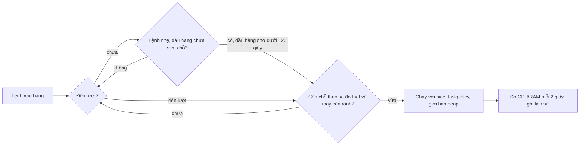

# job-queue

🌐 English | [Tiếng Việt](README.vi.md)

A queue for heavy commands (test, typecheck, build, e2e, image processing...) so the machine does not get overloaded when Claude runs many jobs at once. Pure bash: no background process, no server.

| Component | Purpose |
|---|---|
| `jobq` | Queues commands, limits CPU/RAM/concurrency, enforces timeouts, measures weight, writes data for the web page |
| `jobq-guard` | Claude Code hook that blocks heavy commands run directly instead of through `jobq` |
| `template.sh` + `lint-script` | Shared template for every test/check script, plus the template linter |
| `stepper` | Runs heavy scripts step by step; on failure it stops, and a rerun resumes from the failed step |
| `dashboard.html` | Static page for monitoring the queue, opened with `jobq web` |
| `check-jobq` | Self-test for the whole toolkit, prints a single `PASS`/`FAIL` line (about 1 minute on a busy machine) |

## Installation

```bash
./install.sh --with-scripts   # link this folder into ~/.claude/scripts/job-queue and jobq, stepper, lint-script into ~/.local/bin
```

`~/.local/bin` must be in `PATH`. The last step is not automated (it would edit your `settings.json`): attach the hook in `~/.claude/settings.json` by adding to the `hooks.PreToolUse` array:

```json
{ "matcher": "Bash", "hooks": [{ "type": "command", "command": "$HOME/.claude/scripts/job-queue/jobq-guard", "timeout": 5 }] }
```

## Quick start

```bash
jobq run -- pnpm --filter api test        # queue, then run
jobq run -t 1800 -- pnpm test:e2e         # raise the timeout to 30 minutes
jobq run --cost cpu=3,mem=2000 -- <lệnh>  # declare the weight up front for a command with no history
jobq status                               # who is running, who is waiting, active limits, machine load
jobq stats                                # which commands are heaviest: run count, peak CPU/RAM, duration
jobq web                                  # open the monitoring page
jobq clean                                # clean up slots of dead processes, trim history to 2000 lines
```

Exit codes: the command's own, except `124` (timed out, the whole process tree was stopped and you are told to split the command), `75` (waited in the queue too long) and `130` (interrupted with Ctrl-C).

## How it works



- **Weight score.** Each command gets a CPU and RAM score equal to the peak measured over the last 5 runs of the same command in the same directory. With no history, the default is 2 cores and 2000MB.
- **Self-derived limits.** Nothing to tune by hand: at most one command per core, CPU reservation up to 150% of the core count, RAM up to 75% of total RAM. A command runs when the running total plus its own score stays within the limit; a command heavier than the whole limit still runs when the queue is empty, so the queue never gets stuck.
- **Machine conditions.** Once something is running, the next command waits if CPU load is at or above 150% of the core count, free RAM is below 1500MB, or macOS memory pressure is critical (level 4).
- **Queue jumping.** A light command may go first if the head of the queue does not fit yet. Once the head has waited more than 120 seconds, jumping stops so heavy commands are not starved.
- **Throttling by real measurements.** A command that has run for more than 10 seconds is counted by its measured CPU and RAM (no more estimates), so a command lighter than predicted frees room for others, and a heavier one tightens the limit. Newly started commands still use the estimate to be conservative.
- **Startup cooldown.** After admitting a command, `jobq` waits 8 seconds (`JOBQ_COOLDOWN_SEC`) before admitting the next, so the first one has time to reach its full resource usage and a burst of commands does not all jam up together.
- **Swap brake.** If swap grows by 256MB (`JOBQ_SWAP_GROWTH_MB`) between two samples taken 5 to 60 seconds apart, `jobq` stops admitting new commands for 30 seconds (`JOBQ_SWAP_BRAKE_SEC`).
- **Child environment.** `nice 10` and `taskpolicy -b` (macOS), `NODE_OPTIONS` capping the heap at 3GB, `UV_THREADPOOL_SIZE=2`, and `JOBQ_WORKERS=2` for child scripts to use as their default worker count.
- **Nested calls.** If a child command calls `jobq` again, it runs directly, since the slot is already held.

## Configuration

There is no config file or command for changing numbers: every limit is derived from the machine's core count and RAM, then tightened by real measurements. Only two things are tunable per command: `-t` (maximum seconds for the command, default 900) and `-w` (maximum seconds to wait in the queue, default 7200), plus `--cost cpu=N,mem=MB` to declare the weight in advance for a command with no history. The `JOBQ_*` variables at the top of the `jobq` file are only override points for tests.

## Command history and output

Every command run through `jobq run` is saved in `~/.cache/jobq/runs/` (the 50 most recent, older ones are deleted): metadata (`.meta`), raw output (`.log`) and the web page copy (`.js`). Output goes through `tee`, so the caller still sees it immediately as before, but stdout and stderr are merged. Only the last 512KB of output is kept per command. View it in the terminal with `jobq logs`, or click a row in the "Lịch sử lệnh" (command history) section of the monitoring page. A command killed with `kill -9` is finalized with exit code 137 when `jobq` cleans up.

## Monitoring page

`jobq web` copies `dashboard.html` to `~/.cache/jobq/web/` and opens it in the browser. From then on `jobq` writes `snapshot.js` itself whenever a command is queued, starts or finishes, and every 5 seconds while a command is running. The page reloads this file every 3 seconds, while the "Đã chạy" (elapsed) and "Đã chờ" (waited) timers count up every second in the browser. It works over `file://`.

The page fits one screen with no scrolling. Titled cards sit right under the top bar (there is no separate conclusion sentence, to leave height for content; the reason for waiting is shown per command and per slot), including the machine metrics card (CPU with a small chart, free RAM, RAM pressure; highlighted yellow or red only when a real threshold is exceeded). Below it, two columns: the left column holds the "run slots" (slots with a command and a time bar, empty slots ready to accept a command, slots locked with a diagonal-stripe background when the machine is busy) and the queue with reasons; the right column has three tabs: Command history (50 most recent commands, click a row to see output), Heaviest commands and Glossary, each column scrolling on its own. Below 900px width it stacks into one column and the page scrolls normally. The Chrome tab title is short and puts the key numbers first (`2 chạy 3 chờ · jobq`, or `jobq · rảnh` when nothing is running), and the tab icon changes color with the state, so a glance at the tab bar is enough. There is an Auto, Light, Dark toggle that remembers the choice in the browser. It respects the operating system's reduced-motion setting. `jobq` only writes data when there is a command, so when idle the page shows "Lần cuối có lệnh lúc ..." (last command at ...); and if a command is running but the data has been stale for more than 15 seconds, a warning appears (this happens when `jobq` is killed with `kill -9`). Requires a browser that supports CSS `light-dark()` (Chrome 123, Safari 17.5, Firefox 120 or later).

## The `jobq-guard` hook

Blocks heavy commands that do not go through `jobq run`, including wrapped forms: `time`, `VAR=1`, `npx`, `pnpm -r exec`, `bash -c "..."`, chained commands `a && b`.

- **Package scripts:** `pnpm|npm|yarn|bun` with `test`, `check`, `typecheck`, `build`, `lint`, `format`, `e2e`, `verify`, `generate`, `sdk:generate`, `test:*`, `build:*`...
- **JS/TS tools:** `tsc`, `vitest`, `jest`, `playwright`, `cypress`, `eslint`, `prettier`, `turbo`, `nx`, `webpack`, `esbuild`, `next|ng|astro|nuxt build`, `wrangler deploy`...
- **Other languages:** `cargo`, `go`, `pytest`, `mvn`, `gradle`, `dotnet`, `swift`, `flutter`, `pod install`, `xcodebuild`.
- **System and media:** `make`, `just test`, `docker build`, `ffmpeg`, `magick`, `sips`, `lighthouse`, `k6`.
- **Custom scripts:** names `check-*`, `test-*`, `e2e-*`, `bench-*` invoked via an interpreter or a path.

The queue is never "full": Claude just pushes every independent command in and `jobq` orders them by load and RAM; when Claude looks at `jobq status` or `jobq stats`, the hook reminds it not to use them as a reason to stop pushing commands. A command that already has `jobq run` or `stepper` must run in the background (`run_in_background: true`); otherwise the hook blocks it with a reminder to do other work while waiting; if you need the result right away, put `JOBQ_FG=1` before the command. Allowed through: `pnpm install`, `npm ci`, `pnpm dev`, `wrangler dev`, `git`, `echo`, `grep`, `tar`, `rsync` and every command already wrapped in `jobq run`. Text inside quotes and heredoc bodies is ignored; an unclosed single quote is taken literally, since a false block beats a miss.

To add a new heavy command: edit `NAMES`, `SCRIPTS` or `SCRIPTFILES` in `jobq-guard`, then add a line to the test-case table in `check-jobq`. To remove the hook: delete the last entry of `hooks.PreToolUse`.

## Writing a new test/check script

Every new script starts from `template.sh` and then goes through `lint-script`:

```bash
cp template.sh check-foo.sh && lint-script check-foo.sh
```

Required template: shebang `#!/usr/bin/env bash`, `Usage:` on line 2, `set -euo pipefail`, `--help`, `--scope`, a `trap` that cleans temp files, a final `echo "PASS: ..."` line, and the self-queuing line `exec jobq run -- "$0"` so the script enters the queue even when called directly. `lint-script` also rejects self-parallelism (`&`, `xargs -P`), worker/concurrency above 2, heavy commands not going through `jobq`, and scripts longer than 120 lines.

A heavy script (over 120 lines, running over 2 minutes, or with multiple phases) is split into a folder of `NN-name.sh` files and run with `stepper`:

```bash
stepper plans/scripts/x/steps             # run in order, each step through jobq
stepper <dir> --from 03                   # start from step 03
stepper <dir> --reset                     # clear state, start over from the beginning
```

A failing step stops there; after fixing, rerun the same command to resume from the failed step; steps that already `PASS` are not rerun.

## Common problems

- **Exit `75`:** waited longer than `JOBQ_WAIT`. Run `jobq status`; if a slot is stuck but its process is dead, run `jobq clean`.
- **Exit `124`:** the command timed out. `jobq` prints "QUÁ HẠN ... hãy CHIA NHỎ lệnh" (timed out ... split the command) and records that line in the history, along with the command name and the last 20 output lines so you can see how far it got. Split the command into shorter batches (`jobq split N -- <file...>` or `--shard=i/N`) and push each batch; do not raise `-t`.
- **Only one command runs even though the limit is higher:** the machine is overloaded, low on RAM, swap is growing fast, or the command just admitted is still in its 8-second startup cooldown. `jobq status` shows machine load and free RAM.
- **A child command spawns many workers on its own:** `jobq` cannot limit that, so you must still pass `--concurrency=2`, `--maxWorkers=2`, `--workers=2` to turbo/vitest/jest/playwright.
- **CPU/RAM measurements are only approximate:** they come from `ps` every 2 seconds, RAM is summed so it may overcount for processes sharing memory, and processes that detach into their own group (like Chrome) may not be counted.
- **Your dev servers (api, web) do not go through `jobq`:** they raise machine load, so commands in the queue may wait longer.
