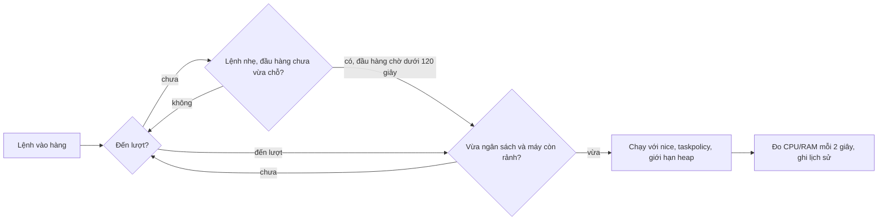

# job-queue

Hàng đợi cho các lệnh nặng (test, typecheck, build, e2e, xử lý ảnh...) để máy không bị quá tải khi Claude chạy nhiều việc cùng lúc. Chỉ cần bash, không có tiến trình nền, không có server.

| Thành phần | Việc làm |
|---|---|
| `jobq` | Xếp hàng, giới hạn CPU/RAM/số lệnh, timeout, đo mức nặng, ghi dữ liệu cho trang web |
| `jobq-guard` | Hook của Claude Code, chặn lệnh nặng chạy thẳng không qua `jobq` |
| `template.sh` + `lint-script` | Khuôn chung cho mọi script test/check và bộ kiểm tra khuôn |
| `stepper` | Chạy script nặng theo từng bước, lỗi thì dừng và chạy lại tiếp từ bước lỗi |
| `dashboard.html` | Trang tĩnh theo dõi hàng đợi, mở bằng `jobq web` |
| `check-jobq` | Tự kiểm tra cả bộ, ra một dòng `PASS`/`FAIL` (khoảng 1 phút khi máy bận) |

## Cài đặt

```bash
./install.sh --with-scripts                              # link vào ~/.claude/scripts/job-queue
ln -s ~/.claude/scripts/job-queue/jobq ~/.local/bin/jobq
ln -s ~/.claude/scripts/job-queue/stepper ~/.local/bin/stepper
ln -s ~/.claude/scripts/job-queue/lint-script ~/.local/bin/lint-script
```

Gắn hook vào `~/.claude/settings.json`, thêm vào mảng `hooks.PreToolUse`:

```json
{ "matcher": "Bash", "hooks": [{ "type": "command", "command": "$HOME/.claude/scripts/job-queue/jobq-guard", "timeout": 5 }] }
```

## Dùng nhanh

```bash
jobq run -- pnpm --filter api test        # xếp hàng rồi chạy
jobq run -t 1800 -- pnpm test:e2e         # nới timeout lên 30 phút
jobq run --cost cpu=3,mem=2000 -- <lệnh>  # khai sẵn mức nặng cho lệnh chưa có lịch sử
jobq status                               # ai đang chạy, ai đang chờ, ngân sách, tải máy
jobq stats                                # lệnh nào nặng nhất: số lần, CPU/RAM lớn nhất, thời gian
jobq web                                  # mở trang theo dõi
jobq budget cpu=6 mem=8000 jobs=3         # đổi ngân sách, có hiệu lực ngay với lệnh đang chờ
jobq max cpu=6 mem=9000 jobs=4            # trần cứng, ngân sách không bao giờ vượt qua
jobq clean                                # dọn chỗ của tiến trình đã chết, cắt lịch sử còn 2000 dòng
```

Mã thoát: của chính lệnh, trừ `124` (quá timeout, đã dừng cả cây tiến trình), `75` (chờ trong hàng quá lâu) và `130` (bị ngắt bằng Ctrl-C).

## Cách hoạt động



- **Điểm nặng.** Mỗi lệnh có điểm CPU và RAM bằng số đo lớn nhất trong 5 lần chạy gần nhất của cùng lệnh ở cùng thư mục. Chưa có lịch sử thì tính mặc định 2 nhân và 2000MB.
- **Ngân sách.** Lệnh được chạy khi tổng điểm đang chạy cộng điểm của nó chưa vượt ngân sách và số lệnh chưa vượt `jobs`. Lệnh nặng hơn cả ngân sách vẫn chạy khi hàng trống, để hàng đợi không kẹt.
- **Điều kiện máy.** Khi đã có lệnh chạy, lệnh tiếp theo chờ nếu tải CPU từ ngưỡng trở lên, RAM trống dưới 1500MB, hoặc áp lực bộ nhớ macOS (`kern.memorystatus_vm_pressure_level`) từ mức 2.
- **Chạy lách.** Lệnh nhẹ được vào trước nếu lệnh đầu hàng chưa vừa chỗ. Đầu hàng chờ quá 120 giây thì dừng cho lách, để lệnh nặng không bị bỏ đói.
- **Tự co giãn.** Máy quá tải thì ngân sách hiệu dụng giảm còn 75% mỗi 10 giây (thấp nhất 25%); máy rảnh thì tăng lại 25 điểm (số lệnh làm tròn gần nhất, nên scale từ 75% vẫn cho 2 lệnh). Không bao giờ vượt ngân sách gốc và trần `max`.
- **Môi trường của lệnh con.** `nice 10` và `taskpolicy -b` (macOS), `NODE_OPTIONS` giới hạn heap 3GB, `UV_THREADPOOL_SIZE=2`, `JOBQ_WORKERS=2` để script con lấy làm số worker mặc định.
- **Gọi lồng nhau.** Lệnh con gọi `jobq` lần nữa thì chạy thẳng, vì đã giữ chỗ.

## Cấu hình

Thứ tự ưu tiên: biến môi trường, rồi `~/.cache/jobq/config`, rồi mặc định.

| Biến | Mặc định | Ý nghĩa |
|---|---|---|
| `JOBQ_SLOTS` | `2` | Số lệnh tối đa chạy cùng lúc (ngân sách) |
| `JOBQ_BUDGET_CPU` / `JOBQ_BUDGET_MEM` | `4` nhân / `6000`MB | Ngân sách CPU và RAM |
| `JOBQ_MAX_JOBS` / `JOBQ_MAX_CPU` / `JOBQ_MAX_MEM` | `4` / 75% số nhân / 60% RAM | Trần cứng cho ngân sách |
| `JOBQ_TIMEOUT` | `900` | Giây trước khi dừng lệnh chạy quá lâu |
| `JOBQ_WAIT` | `1800` | Giây chờ tối đa trong hàng trước khi bỏ cuộc |
| `JOBQ_MAX_LOAD` | 75% số nhân | Ngưỡng tải CPU chặn lệnh mới; đặt lâu dài bằng `jobq max load=10` |
| `JOBQ_MIN_FREE_MB` | `1500` | RAM trống tối thiểu để nhận lệnh mới |
| `JOBQ_MAX_PRESSURE` | `2` | Mức áp lực bộ nhớ macOS chặn lệnh mới |
| `JOBQ_BACKFILL_SEC` | `120` | Đầu hàng chờ quá ngần này thì không cho chạy lách |
| `JOBQ_ADAPT` / `JOBQ_ADAPT_SEC` | `1` / `10` | Bật tự co giãn / chu kỳ điều chỉnh |
| `JOBQ_NODE_MB` | `3072` | Trần heap cho tiến trình node con |
| `JOBQ_DIR` | `~/.cache/jobq` | Nơi lưu trạng thái |

## Trang theo dõi

`jobq web` copy `dashboard.html` vào `~/.cache/jobq/web/` rồi mở bằng trình duyệt. Từ đó `jobq` tự ghi `snapshot.js` khi có lệnh vào hàng, bắt đầu hoặc kết thúc, và mỗi 5 giây khi có lệnh đang chạy. Trang nạp lại file này mỗi 3 giây, còn thời gian "Đã chạy" và "Đã chờ" tự đếm mỗi giây ngay trên trình duyệt. Chạy được qua `file://`.

Trang viết bằng lời thường: trên cùng là một câu nói thẳng trạng thái ("Máy đang rảnh, lệnh mới sẽ chạy ngay", "Đang chạy 1 lệnh, 2 lệnh đang xếp hàng chờ") kèm lý do khi máy bận. Bên dưới là ba thẻ tình trạng máy (CPU, RAM trống, áp lực bộ nhớ), danh sách lệnh đang chạy (có thanh thời gian so với giới hạn), danh sách lệnh đang chờ (mỗi lệnh có dòng giải thích vì sao đang chờ), bảng lệnh tốn tài nguyên nhất, và phần giải thích các từ. Có nút chọn giao diện Tự động, Sáng hoặc Tối; lựa chọn được nhớ trong trình duyệt. Không còn lệnh nào chạy thì trang giữ trạng thái cuối; nếu dữ liệu cũ hơn 15 giây mà vẫn hiện lệnh đang chạy thì có ô cảnh báo (xảy ra khi `jobq` bị `kill -9`). Cần trình duyệt hỗ trợ CSS `light-dark()` (Chrome 123, Safari 17.5, Firefox 120 trở lên).

## Hook `jobq-guard`

Chặn lệnh nặng khi không đi qua `jobq run`, kể cả dạng bọc: `time`, `VAR=1`, `npx`, `pnpm -r exec`, `bash -c "..."`, lệnh nối `a && b`.

- **Script của gói:** `pnpm|npm|yarn|bun` với `test`, `check`, `typecheck`, `build`, `lint`, `format`, `e2e`, `verify`, `generate`, `sdk:generate`, `test:*`, `build:*`...
- **Công cụ JS/TS:** `tsc`, `vitest`, `jest`, `playwright`, `cypress`, `eslint`, `prettier`, `turbo`, `nx`, `webpack`, `esbuild`, `next|ng|astro|nuxt build`, `wrangler deploy`...
- **Ngôn ngữ khác:** `cargo`, `go`, `pytest`, `mvn`, `gradle`, `dotnet`, `swift`, `flutter`, `pod install`, `xcodebuild`.
- **Hệ thống và media:** `make`, `just test`, `docker build`, `ffmpeg`, `magick`, `sips`, `lighthouse`, `k6`.
- **Script tự viết:** tên `check-*`, `test-*`, `e2e-*`, `bench-*` gọi bằng interpreter hoặc đường dẫn.

Cho qua: `pnpm install`, `npm ci`, `pnpm dev`, `wrangler dev`, `git`, `echo`, `grep`, `tar`, `rsync` và mọi lệnh đã có `jobq run`. Chữ nằm trong dấu nháy và nội dung heredoc được bỏ qua; nháy lẻ không đóng thì dùng nguyên văn, thà chặn thừa còn hơn để lọt.

Thêm lệnh nặng mới: sửa `NAMES`, `SCRIPTS` hoặc `SCRIPTFILES` trong `jobq-guard`, rồi thêm một dòng vào bảng ca thử trong `check-jobq`. Gỡ hook: xoá mục cuối của `hooks.PreToolUse`.

## Viết script test/check mới

Mọi script mới bắt đầu từ `template.sh` rồi qua `lint-script`:

```bash
cp template.sh check-foo.sh && lint-script check-foo.sh
```

Khuôn bắt buộc: shebang `#!/usr/bin/env bash`, dòng 2 có `Usage:`, `set -euo pipefail`, `--help`, `--scope`, `trap` dọn tệp tạm, dòng cuối `echo "PASS: ..."`, và dòng tự xếp hàng `exec jobq run -- "$0"` nên script vào hàng dù gọi thẳng. `lint-script` còn chặn tự chạy song song (`&`, `xargs -P`), worker/concurrency lớn hơn 2, gọi lệnh nặng không qua `jobq`, và script dài hơn 120 dòng.

Script nặng (quá 120 dòng, chạy quá 2 phút, hoặc nhiều pha) tách thành thư mục `NN-tên.sh` rồi chạy bằng `stepper`:

```bash
stepper plans/scripts/x/steps             # chạy lần lượt, mỗi bước qua jobq
stepper <dir> --from 03                   # bắt đầu từ bước 03
stepper <dir> --reset                     # xoá trạng thái, chạy lại từ đầu
```

Bước nào lỗi thì dừng tại đó; sửa xong chạy lại cùng lệnh để tiếp từ bước lỗi, bước đã `PASS` không chạy lại.

## Lỗi hay gặp

- **Exit `75`:** chờ quá `JOBQ_WAIT`. Chạy `jobq status`; nếu có chỗ treo mà tiến trình đã chết thì `jobq clean`.
- **Exit `124`:** lệnh quá timeout. Tăng `-t` rồi chạy lại.
- **Chỉ một lệnh chạy dù ngân sách là 2:** máy đang quá tải, thiếu RAM hoặc áp lực bộ nhớ cao. `jobq status` hiện `scale=` và tải máy; tắt co giãn bằng `JOBQ_ADAPT=0`.
- **Lệnh con tự sinh nhiều worker:** `jobq` không giới hạn được, vẫn phải truyền `--concurrency=2`, `--maxWorkers=2`, `--workers=2` cho turbo/vitest/jest/playwright.
- **Số đo CPU/RAM chỉ gần đúng:** lấy từ `ps` mỗi 2 giây, RAM cộng dồn nên có thể thừa với tiến trình dùng chung bộ nhớ, và tiến trình tự tách nhóm (như Chrome) có thể không được tính.
- **Dev server của bạn (api, web) không đi qua `jobq`:** chúng làm tải máy tăng nên lệnh trong hàng có thể chờ lâu hơn.
