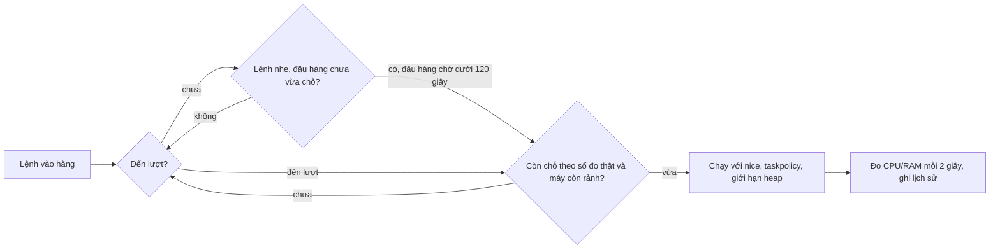

# job-queue

🌐 [English](README.md) | Tiếng Việt

Hàng đợi cho các lệnh nặng (test, typecheck, build, e2e, xử lý ảnh...) để máy không bị quá tải khi Claude chạy nhiều việc cùng lúc. Chỉ cần bash, không có tiến trình nền, không có server.

| Thành phần | Việc làm |
|---|---|
| `jobq` | Xếp hàng, giới hạn CPU/RAM/số lệnh, timeout, đo mức nặng, ghi dữ liệu cho trang web |
| `jobq-guard` | Hook của Claude Code, chặn lệnh nặng chạy thẳng không qua `jobq` |
| `template.sh` + `lint-script` | Khuôn chung cho mọi script test/check và bộ kiểm tra khuôn |
| `stepper` | Chạy script nặng theo từng bước, lỗi thì dừng và chạy lại tiếp từ bước lỗi |
| `dashboard.html` | Trang tĩnh theo dõi hàng đợi, mở bằng `jobq web` |
| `check-jobq` | Tự kiểm tra cả bộ, ra một dòng `PASS`/`FAIL` (khoảng 1 phút khi máy bận) |

## Cài đặt

```bash
./install.sh --with-scripts   # link thư mục này vào ~/.claude/scripts/job-queue và jobq, stepper, lint-script vào ~/.local/bin
```

Cần `~/.local/bin` có trong `PATH`. Bước cuối chưa tự động (vì sẽ sửa `settings.json` của bạn): gắn hook vào `~/.claude/settings.json`, thêm vào mảng `hooks.PreToolUse`:

```json
{ "matcher": "Bash", "hooks": [{ "type": "command", "command": "$HOME/.claude/scripts/job-queue/jobq-guard", "timeout": 5 }] }
```

## Dùng nhanh

```bash
jobq run -- pnpm --filter api test        # xếp hàng rồi chạy
jobq run -t 1800 -- pnpm test:e2e         # nới timeout lên 30 phút
jobq run --cost cpu=3,mem=2000 -- <lệnh>  # khai sẵn mức nặng cho lệnh chưa có lịch sử
jobq status                               # ai đang chạy, ai đang chờ, giới hạn đang áp dụng, tải máy
jobq stats                                # lệnh nào nặng nhất: số lần, CPU/RAM lớn nhất, thời gian
jobq web                                  # mở trang theo dõi
jobq clean                                # dọn chỗ của tiến trình đã chết, cắt lịch sử còn 2000 dòng
```

Mã thoát: của chính lệnh, trừ `124` (quá hạn, đã dừng cả cây tiến trình và báo phải chia nhỏ lệnh), `75` (chờ trong hàng quá lâu) và `130` (bị ngắt bằng Ctrl-C).

## Cách hoạt động



- **Điểm nặng.** Mỗi lệnh có điểm CPU và RAM bằng số đo lớn nhất trong 5 lần chạy gần nhất của cùng lệnh ở cùng thư mục. Chưa có lịch sử thì tính mặc định 2 nhân và 2000MB.
- **Giới hạn tự suy ra.** Không có gì để chỉnh tay: tối đa mỗi nhân một lệnh, đặt chỗ CPU tối đa 150% số nhân, RAM tối đa 75% tổng RAM. Lệnh được chạy khi tổng điểm đang chạy cộng điểm của nó chưa vượt giới hạn; lệnh nặng hơn cả giới hạn vẫn chạy khi hàng trống, để hàng đợi không kẹt.
- **Điều kiện máy.** Khi đã có lệnh chạy, lệnh tiếp theo chờ nếu tải CPU từ 150% số nhân trở lên, RAM trống dưới 1500MB, hoặc áp lực bộ nhớ macOS ở mức nguy cấp (mức 4).
- **Chạy lách.** Lệnh nhẹ được vào trước nếu lệnh đầu hàng chưa vừa chỗ. Đầu hàng chờ quá 120 giây thì dừng cho lách, để lệnh nặng không bị bỏ đói.
- **Điều tiết theo số đo thật.** Lệnh đã chạy quá 10 giây được tính theo CPU và RAM đo thật (không dùng ước lượng nữa), nên lệnh nhẹ hơn dự đoán thì nhường chỗ cho lệnh khác, lệnh nặng hơn dự đoán thì chặn bớt. Lệnh mới chạy vẫn tính theo ước lượng cho thận trọng.
- **Chờ khởi động.** Sau khi nhận một lệnh, `jobq` đợi 8 giây (`JOBQ_COOLDOWN_SEC`) rồi mới nhận lệnh tiếp, để lệnh kia kịp dùng đủ tài nguyên, tránh nhận một loạt lệnh cùng lúc rồi cùng nghẽn.
- **Phanh theo swap.** Swap tăng từ 256MB (`JOBQ_SWAP_GROWTH_MB`) giữa hai lần đo cách nhau 5 đến 60 giây thì ngừng nhận lệnh mới 30 giây (`JOBQ_SWAP_BRAKE_SEC`).
- **Môi trường của lệnh con.** `nice 10` và `taskpolicy -b` (macOS), `NODE_OPTIONS` giới hạn heap 3GB, `UV_THREADPOOL_SIZE=2`, `JOBQ_WORKERS=2` để script con lấy làm số worker mặc định.
- **Gọi lồng nhau.** Lệnh con gọi `jobq` lần nữa thì chạy thẳng, vì đã giữ chỗ.

## Cấu hình

Không có tệp cấu hình hay lệnh chỉnh số: mọi giới hạn tự suy ra từ số nhân và RAM của máy rồi được siết thêm bằng số đo thật. Chỉ còn hai thứ chỉnh theo từng lệnh: `-t` (giây tối đa cho lệnh, mặc định 900) và `-w` (giây chờ tối đa trong hàng, mặc định 7200), cùng `--cost cpu=N,mem=MB` để khai trước mức nặng cho lệnh chưa có lịch sử. Các biến `JOBQ_*` trong đầu tệp `jobq` chỉ là điểm ghi đè cho kiểm thử.

## Lịch sử lệnh và output

Mỗi lệnh chạy qua `jobq run` được lưu vào `~/.cache/jobq/runs/` (50 lệnh gần nhất, cũ hơn bị xoá): thông tin (`.meta`), output thô (`.log`) và bản cho trang web (`.js`). Output đi qua `tee` nên người gọi vẫn thấy ngay như cũ, nhưng stdout và stderr được gộp chung. Mỗi lệnh chỉ giữ 512KB cuối của output. Xem trong terminal bằng `jobq logs`, hoặc bấm vào dòng trong mục "Lịch sử lệnh" của trang theo dõi. Lệnh bị `kill -9` được chốt mã 137 khi `jobq` dọn.

## Trang theo dõi

`jobq web` copy `dashboard.html` vào `~/.cache/jobq/web/` rồi mở bằng trình duyệt. Từ đó `jobq` tự ghi `snapshot.js` khi có lệnh vào hàng, bắt đầu hoặc kết thúc, và mỗi 5 giây khi có lệnh đang chạy. Trang nạp lại file này mỗi 3 giây, còn thời gian "Đã chạy" và "Đã chờ" tự đếm mỗi giây ngay trên trình duyệt. Chạy được qua `file://`.

Trang vừa một màn hình, không phải cuộn. Các ô có tiêu đề nằm ngay dưới thanh trên cùng (không còn câu kết luận riêng để chừa chiều cao cho nội dung; lý do chờ nằm ở từng lệnh và từng chỗ chạy), gồm ô chỉ số máy (CPU kèm biểu đồ nhỏ, RAM còn trống, áp lực RAM; chỉ tô vàng hoặc đỏ khi vượt ngưỡng thật). Bên dưới chia hai cột: cột trái là các "chỗ chạy" (chỗ có lệnh kèm thanh thời gian, chỗ trống sẵn sàng nhận lệnh, chỗ bị khoá nền gạch chéo khi máy bận) và hàng chờ kèm lý do; cột phải có ba tab: Lịch sử lệnh (50 lệnh gần nhất, bấm vào dòng để xem output), Lệnh hay tốn máy và Giải thích từ, mỗi cột cuộn riêng. Dưới 900px chiều rộng thì xếp một cột và trang cuộn bình thường. Tiêu đề tab Chrome ngắn và đặt số quan trọng lên đầu (`2 chạy 3 chờ · jobq`, hoặc `jobq · rảnh` khi không có lệnh), biểu tượng tab đổi màu theo trạng thái, nên liếc thanh tab là biết. Có nút chọn Tự động, Sáng, Tối, nhớ lựa chọn trong trình duyệt. Tôn trọng chế độ giảm chuyển động của hệ điều hành. jobq chỉ ghi dữ liệu khi có lệnh, nên lúc rảnh trang hiện "Lần cuối có lệnh lúc ..."; còn lệnh đang chạy mà dữ liệu đứng yên hơn 15 giây thì có cảnh báo (xảy ra khi `jobq` bị `kill -9`). Cần trình duyệt hỗ trợ CSS `light-dark()` (Chrome 123, Safari 17.5, Firefox 120 trở lên).

## Hook `jobq-guard`

Chặn lệnh nặng khi không đi qua `jobq run`, kể cả dạng bọc: `time`, `VAR=1`, `npx`, `pnpm -r exec`, `bash -c "..."`, lệnh nối `a && b`.

- **Script của gói:** `pnpm|npm|yarn|bun` với `test`, `check`, `typecheck`, `build`, `lint`, `format`, `e2e`, `verify`, `generate`, `sdk:generate`, `test:*`, `build:*`...
- **Công cụ JS/TS:** `tsc`, `vitest`, `jest`, `playwright`, `cypress`, `eslint`, `prettier`, `turbo`, `nx`, `webpack`, `esbuild`, `next|ng|astro|nuxt build`, `wrangler deploy`...
- **Ngôn ngữ khác:** `cargo`, `go`, `pytest`, `mvn`, `gradle`, `dotnet`, `swift`, `flutter`, `pod install`, `xcodebuild`.
- **Hệ thống và media:** `make`, `just test`, `docker build`, `ffmpeg`, `magick`, `sips`, `lighthouse`, `k6`.
- **Script tự viết:** tên `check-*`, `test-*`, `e2e-*`, `bench-*` gọi bằng interpreter hoặc đường dẫn.

Hàng đợi không bao giờ "đầy": Claude cứ đẩy mọi lệnh độc lập vào, `jobq` tự xếp theo tải và RAM; khi Claude xem `jobq status` hoặc `jobq stats`, hook nhắc đừng dựa vào đó để ngừng đẩy lệnh. Lệnh đã có `jobq run` hoặc `stepper` thì bắt buộc chạy nền (`run_in_background: true`), nếu không hook chặn kèm lời nhắc làm việc khác trong lúc chờ; cần kết quả ngay thì thêm `JOBQ_FG=1` trước lệnh. Cho qua: `pnpm install`, `npm ci`, `pnpm dev`, `wrangler dev`, `git`, `echo`, `grep`, `tar`, `rsync` và mọi lệnh đã có `jobq run`. Chữ nằm trong dấu nháy và nội dung heredoc được bỏ qua; nháy lẻ không đóng thì dùng nguyên văn, thà chặn thừa còn hơn để lọt.

Thêm lệnh nặng mới: sửa `NAMES`, `SCRIPTS` hoặc `SCRIPTFILES` trong `jobq-guard`, rồi thêm một dòng vào bảng ca thử trong `check-jobq`. Gỡ hook: xoá mục cuối của `hooks.PreToolUse`.

## Viết script test/check mới

Mọi script mới bắt đầu từ `template.sh` rồi qua `lint-script`:

```bash
cp template.sh check-foo.sh && lint-script check-foo.sh
```

Khuôn bắt buộc: shebang `#!/usr/bin/env bash`, dòng 2 có `Usage:`, `set -euo pipefail`, `--help`, `--scope`, `trap` dọn tệp tạm, dòng cuối `echo "PASS: ..."`, và dòng tự xếp hàng `exec jobq run -- "$0"` nên script vào hàng dù gọi thẳng. `lint-script` còn chặn tự chạy song song (`&`, `xargs -P`), worker/concurrency lớn hơn 2, gọi lệnh nặng không qua `jobq`, và script dài hơn 120 dòng.

Script nặng (quá 120 dòng, chạy quá 2 phút, hoặc nhiều pha) tách thành thư mục `NN-tên.sh` rồi chạy bằng `stepper`:

```bash
stepper plans/scripts/x/steps             # chạy lần lượt, mỗi bước qua jobq
stepper <dir> --from 03                   # bắt đầu từ bước 03
stepper <dir> --reset                     # xoá trạng thái, chạy lại từ đầu
```

Bước nào lỗi thì dừng tại đó; sửa xong chạy lại cùng lệnh để tiếp từ bước lỗi, bước đã `PASS` không chạy lại.

## Lỗi hay gặp

- **Exit `75`:** chờ quá `JOBQ_WAIT`. Chạy `jobq status`; nếu có chỗ treo mà tiến trình đã chết thì `jobq clean`.
- **Exit `124`:** lệnh quá hạn. `jobq` in "QUÁ HẠN ... hãy CHIA NHỎ lệnh" và ghi dòng đó vào lịch sử, kèm tên lệnh và 20 dòng output cuối để biết lệnh chạy tới đâu. Chia lệnh thành các lô ngắn hơn (`jobq split N -- <file...>` hoặc `--shard=i/N`) rồi đẩy từng lô, đừng tăng `-t`.
- **Chỉ một lệnh chạy dù giới hạn cao hơn:** máy đang quá tải, thiếu RAM, swap tăng nhanh, hoặc lệnh vừa được nhận còn trong 8 giây chờ khởi động. `jobq status` hiện tải máy và RAM trống.
- **Lệnh con tự sinh nhiều worker:** `jobq` không giới hạn được, vẫn phải truyền `--concurrency=2`, `--maxWorkers=2`, `--workers=2` cho turbo/vitest/jest/playwright.
- **Số đo CPU/RAM chỉ gần đúng:** lấy từ `ps` mỗi 2 giây, RAM cộng dồn nên có thể thừa với tiến trình dùng chung bộ nhớ, và tiến trình tự tách nhóm (như Chrome) có thể không được tính.
- **Dev server của bạn (api, web) không đi qua `jobq`:** chúng làm tải máy tăng nên lệnh trong hàng có thể chờ lâu hơn.
